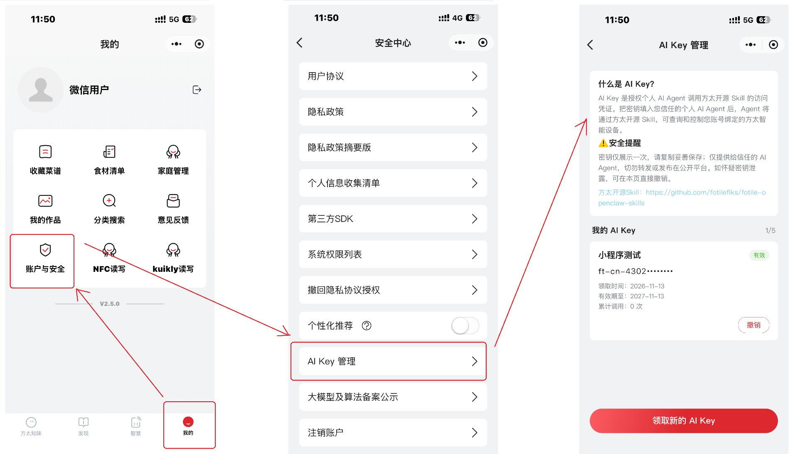

# 方太智能厨电 AI 技能 · FOTILE Intelligent Kitchen Appliances AI Skills

  

|          |                     |
| -------- | ------------------- |
| **简体中文** | [English](#english) |

方太（FOTILE）官方 Agent Skills，让 OpenClaw、Claude Code、Cursor、Gemini CLI 等任何支持 [Agent Skills](https://agentskills.io)（`SKILL.md`）标准的 AI 智能体，用一句自然语言查询和控制**你自己的**方太智能厨电。

> 仓库名沿用了早期的 OpenClaw 命名习惯，但技能本身遵循通用 Agent Skills 标准，不依赖任何特定 harness —— 凡支持 `SKILL.md` 的智能体均可使用。

> ⚠️ **当前为测试版本，默认连接方太内部测试环境，仅供评估与联调。** 生产地址就绪后会更新默认域名，届时无需改代码。详见[当前状态与限制](#当前状态与限制)。

---

## 这是什么

装上这个技能后，你可以直接对 AI 说「油烟机调到三档」「蒸烤箱 180 度预热」，不用打开任何 App。

- **一个 Key 就够**：在方太小程序自助领取，长期有效，随时可撤销
- **只碰该 Key 账号可见的设备**：含绑定给你、以及被授权共享给你的设备（AI 通道不按家庭 / 房间过滤），看不到也控制不了别人的设备
- **不碰局域网**：全程云端 HTTPS，不需要同一 WiFi、不需要设备密钥、不改固件
- **不碰危险操作**：解绑、配网、OTA、账号管理都不在开放范围内

## 能做什么

| 品类                                                                | 典型能力                | 状态查询 | 控制 |
| ----------------------------------------------------------------- | ------------------- | ---- | -- |
| [油烟机](fotile-cloud-control/references/range-hood.md)              | 开关、风量档位、照明、延时关机、升降  | ✅    | ✅  |
| [灶蒸烤箱](fotile-cloud-control/references/stove-steamer-oven.md)     | 模式、温度、时长、湿度、智能灶/温控灶 | ✅    | ✅  |
| [蒸烤微](fotile-cloud-control/references/steam-oven-microwave.md)    | 模式、温度、时长、湿度、快速预热    | ✅    | ✅  |
| [洗碗机](fotile-cloud-control/references/dishwasher.md)              | 程序、启动/暂停、预约、漂洗剂挡位   | ✅    | ✅  |
| [冰箱](fotile-cloud-control/references/refrigerator.md)             | 冷藏/冷冻温度、速冷速冻、保鲜、净味  | ✅    | ✅  |
| [消毒柜](fotile-cloud-control/references/sterilizer.md)              | 消毒程序、暂停/取消、长效保洁、新风  | ✅    | ✅  |
| [净水机](fotile-cloud-control/references/water-purifier.md)          | 冲洗、出水时长、制冰、滤芯寿命     | ✅    | ✅  |
| [净热一体机](fotile-cloud-control/references/water-purifier-heater.md) | 冲洗、冷热水出水时长          | ✅    | ✅  |
| [净食机](fotile-cloud-control/references/food-purifier.md)           | 净化程序、暂停/取消、排水       | ✅    | ✅  |
| [灶具](fotile-cloud-control/references/stove.md)                    | 仅左右灶状态              | ✅    | ❌  |
| [燃气热水器](fotile-cloud-control/references/water-heater.md)          | 仅原始状态               | ✅    | ❌  |

> **上表是品类级能力边界，不代表某一台具体设备。** 实际能控什么，取决于该型号有没有接入标准协议、协议覆盖是否被裁剪。同品类不同型号差异可能很大——某款洗碗机能控 3 个功能，另一款 14 个功能。因此拒绝分两级：

| code    | 含义          | 应对            |
| ------- | ----------- | ------------- |
| `40305` | 该型号未接入标准协议  | 无法远程控制，改用 App |
| `40306` | 型号能控，但该功能未配 | 换功能，或改用 App   |

接口整体提供三类操作：`DeviceDiscovery`（设备列表）、`DeviceSnapshot`（状态查询）、`DeviceCommand`（设备控制）。远程授权 `RemoteAuth` / `LocalControlOnly` 跨品类通用，控制前先校验。智能体不猜参数，也不会把「指令发出但设备没动」当成成功。

灶具与燃气热水器的「控制」为 ❌ —— 标准物模型未定义可控功能，且灶具属燃气设备，点火与火力极高危，故禁止下发任何指令。

各品类的可读字段、可写功能、枚举与取值范围见 [`fotile-cloud-control/references/`](fotile-cloud-control/references)。

### 使用示例

```text
你：我有哪些方太设备？
AI：（列出设备名、型号、deviceId；设备列表不含在线状态与房间信息）

你：油烟机调到三档
AI：（校验物模型 → 下发 → 回读确认 → 告知结果）

你：蒸烤箱现在多少度？
AI：（返回当前腔体温度与运行模式）

你：把洗碗机关掉
AI：（若离线只报告，不盲目下发）
```

## 怎么用

> 无论选哪种安装方式，都要先领一枚 AI Key —— 这一步涉及你的账号授权，无法由 Agent 代劳。

### 第 1 步：领一枚 AI Key

1. 在**方太幸福家 App** / **方太知味小程序**中绑定你的厨电设备。
2. 打开微信 → **「方太知味」小程序** → 登录 → **我的 → 账户与安全 → AI Key 管理** → 点击「获取 AI Key」。
3. 阅读授权范围并同意。系统生成一枚个人 Key（`ft-cn-` 开头），**只展示这一次**。
4. 复制它。之后可在同一页面查看或撤销。一个 Key 可同时配到多个个人 AI Agent。

<p align="center"> </p>

### 第 2 步：安装与配置（二选一）

**让 Agent 自己装（推荐）**

把本仓库地址告诉你的个人 AI Agent，例如直接说：

> 帮我安装这个技能：<https://github.com/fotilefiks/fotile-openclaw-skills>

它会自己克隆代码、把 `fotile-cloud-control/` 装进 skills 目录，并用你上面领到的 Key 完成配置。你不用看下面的手动步骤。

**手动安装**

把 `fotile-cloud-control/` 目录复制到你所用智能体的 skills 目录：

```text
workspace/skills/     或   ~/.agents/skills/     或   ~/.openclaw/skills/
└── fotile-cloud-control/
    ├── SKILL.md
    ├── scripts/
    └── references/
```

然后用自然语言说话即可。若要以 Python 客户端 / CLI 方式使用，**无需安装任何第三方依赖**：脚本优先使用 `requests`，未安装时自动回退到 Python 标准库 `urllib`。如需启用 `requests`（可选）：

```bash
pip install -r fotile-cloud-control/scripts/requirements.txt
```

```python
from fotile_api import FotileAPI

api = FotileAPI()                 # 自动查找 Key
devices = api.list_devices()      # 全量设备：显式分页，不受默认 50 台截断影响
meta = api.discover_devices()     # 同上，另含 total / complete / missing 元信息
status = api.get_status(["<deviceId>"])  # 自动分批查询状态（默认每批 20 台）
api.control(prod_id="<prodId>", device_id="<deviceId>",
            sid="FanLevel", command={"FanLevel": 3})
```

**配置 Key**

**不需要配环境变量。** 在仓库根目录执行，两种写法：

```bash
# 方式 A（推荐）：交互式输入，粘贴时内容不显示，Key 不进命令行历史或对话记录
python fotile-cloud-control/scripts/fotile_api.py login

# 方式 B：把 Key 直接当参数传入 —— 适合你已复制好 Key、交给 Agent 一步跑完；
#         代价是 Key 会留在对话记录和 shell 历史里
python fotile-cloud-control/scripts/fotile_api.py login ft-cn-xxxxxxxx
```

两种方式的 `login` 都会**先向服务器验证 Key 有效，再写入磁盘**——所以打错字不会留下一个坏 Key，验证失败时会保留你原有的可用 Key。介意 Key 留在对话记录里的话，去小程序同一页面**撤销后重新领一枚**即可——撤销会让所有用它的助手立刻失效。

Key 的查找顺序（先命中先用）：

| 优先级 | 位置                    | 适用场景               |
| --- | --------------------- | ------------------ |
| 1   | 环境变量 `FOTILE_API_KEY` | CI / 开发者           |
| 2   | `./.fotile_key`       | 单个项目（已 gitignore）  |
| 3   | `~/.fotile/api_key`   | 普通用户，`login` 默认写这里 |

随时在仓库根目录检查当前状态：

```bash
python fotile-cloud-control/scripts/fotile_api.py whoami
```

输出是结构化 JSON，`state` 字段告诉你当前处于哪个阶段：

| `state`       | 含义                      |
| ------------- | ----------------------- |
| `NO_KEY`      | 还没配置 Key                |
| `KEY_INVALID` | Key 无效 / 已撤销 / 已过期      |
| `NO_DEVICE`   | Key 有效，但账号下没有设备         |
| `READY`       | 一切正常，可以用了               |
| `UNREACHABLE` | 网络或服务暂时不可达（Key 本身可能没问题） |

**首次使用会发生什么**

这个技能被设计成**不需要看文档也能上手**。第一次对话时，智能体会先跑一次 `whoami` 判断你的状态，然后按对应场景引导你：

| 你的状态         | 智能体怎么说                            |
| ------------ | --------------------------------- |
| 没有 Key       | 先说明能帮你做什么，再给出领取 Key 的准确路径，然后等你去领  |
| Key 失效了      | 告诉你 Key 已失效，请重新领一枚；旧的不用管，会被自动覆盖   |
| 有 Key 但看不到设备 | 提示可能是「还没绑定设备」或「绑到了另一个账号」，不会凭空编造设备 |
| 一切就绪         | 直接确认设备数量，给出几个示例说法，然后开始干活          |
| 网络不通         | 说明服务暂时不可达，让你稍后再试——**不会**让你去重领 Key |

收下你的 Key 后，智能体一定会告诉你两件事：Key 存在本机、同时也在对话记录里；以及可以随时撤销重领。这是刻意的设计，不是啰嗦。

## 仓库结构

```text
fotile-openclaw-skills/
├── README.md                    # 本文件（中英双语）
├── LICENSE                      # MIT
├── images/
│   ├── wechat-ai-key-path.jpg   # 小程序内 AI Key 菜单位置示意
│   └── wechat-qrcode.png        # 方太知味小程序码（体验版）
└── fotile-cloud-control/        # 权威、自包含的 Agent Skill
    ├── SKILL.md                 # 技能定义与智能体行为约定
    ├── scripts/
    │   ├── fotile_api.py        # Python 客户端 + CLI
    │   └── requirements.txt
    └── references/              # 品类物模型（12 份，全部完整）
```

## API 说明

所有业务请求为 `POST {FOTILE_API_BASE}/open-cloud/v1/ai/api`，请求头带 `Authorization: Bearer <key>`，请求体用 `header.namespace` 区分操作：

| namespace         | 作用       | 关键 payload                                              |
| ----------------- | -------- | ------------------------------------------------------- |
| `DeviceDiscovery` | 查询绑定设备列表 | `{ "page": 1, "pageSize": 1000 }`                      |
| `DeviceSnapshot`  | 查询设备当前状态 | `{ "thirdPartyDevIds": [...] }`                         |
| `DeviceCommand`   | 下发控制指令   | `{ "command": { prodId, thirdPartyDevId, sid, data } }` |

**分页（重要）**：`DeviceDiscovery` 不传 `page` / `pageSize` 时，服务端**只返回默认首页 50 台**，即使账号下有几百台。响应会带 `payload.total` 与 `payload.hasMore`；客户端必须显式传分页参数、按 `hasMore` 继续拉取，并按 `thirdPartyDevId` 跨页去重（服务端分页 SQL 无稳定排序）。`total` 是数据库原始计数，物模型转换失败的设备会被服务端跳过、翻页也补不回来，因此 `devices` 实际条数可能少于 `total`——这种情况要如实告知用户，不能把截断结果当成全量。

`SKILL.md` 的 `discover_devices()` 已实现上述逻辑；CLI 用 `python scripts/fotile_api.py devices --meta` 查看 `total` / `complete` / `missing`。**在线状态不在此响应中**，需另调 `DeviceSnapshot` 读 `devices[].status`；响应也不含家庭 / 房间字段，AI 通道不按家庭过滤，账号下被授权共享的设备同样在范围内。

响应恒为两层信封：

```json
{ "header": { "...": "..." }, "payload": { "code": 0, "description": "success", "...": "..." } }
```

**判断成功只看 `payload.code === 0`。** HTTP 状态码恒为 200，不能用来判错。

Key 管理另有三个接口（`POST /v1/ai/keys`、`GET /v1/ai/keys`、`DELETE /v1/ai/keys/{id}`），由小程序前端调用，`SKILL.md` 流程不涉及。

## 错误码

| code    | 含义         | 建议动作                               |
| ------- | ---------- | ---------------------------------- |
| `0`     | 成功         | —                                  |
| `40001` | 请求参数错误     | 检查报文结构                             |
| `40100` | 没有携带凭证     | 检查 Key 是否配置                        |
| `40101` | Key 无效     | 重新领取                               |
| `40102` | 凭证与用户不匹配   | 重新领取                               |
| `40103` | Key 已被撤销   | 重新领取                               |
| `40104` | Key 已过期    | 重新领取                               |
| `40301` | 该操作不开放     | 说明不支持，不要重试                         |
| `40302` | 设备不属于该账号   | 重新列出设备确认 id                        |
| `40304` | Key 数量超上限  | 先撤销不用的                             |
| `40305` | 该型号未接入标准协议 | 不能控制；改为查询状态，并提示用 App 或小程序操作        |
| `40306` | 该功能未接入标准协议 | 型号能控但这个功能没配；换功能或提示用 App，不要重试同一 sid |
| `42901` | 触发限流       | 客户端已自动退避重试；仍失败则稍后再试                |
| `10009` | 设备不存在      | 重新列出设备确认 id                        |
| `10011` | 设备离线       | 只报告，不要排队重试                         |
| `10098` | 设备处于本地控制中  | 提示用户在设备端退出本地控制                     |
| `10099` | 设备未开启远程授权  | 提示用户在 App 内开启远程控制                  |
| `99999` | 服务端异常      | 重试一次，仍失败则报告                        |

CLI 会把错误码翻译成人话（`hint` 字段），并自动对 `42901` 做指数退避。

## 安全机制

- **只碰该 Key 账号可见的设备**：含绑定给你、以及被家庭管理员授权共享给你的设备（AI 通道不按家庭 / 房间过滤）；服务端逐个校验设备归属，越权请求返回 `40302`
- **匹配到多个设备时绝不猜**：智能体列出设备名 + deviceId + 型号请你选（设备列表不含房间字段）
- **设备离线只报告**：不盲目下发、不排队
- **下发前按物模型校验**：枚举值、min/max/step 严格检查，绝不写只读字段
- **下发后回读确认**：状态真的变了才告诉你成功
- **高危操作强制确认**：燃气点火、童锁/门锁解除、无人值守加热必须你明确确认
- **管理类操作不开放**：解绑、配网、OTA、账号管理请用方太幸福家 App
- **危险能力封禁**：解绑、配网验证码、授权变更等接口在服务端对 AI 通道直接拒绝

## 常见问题

**Q：Key 会不会泄露我的隐私？** 只能访问该 Key 账号可见的设备（含被授权共享给你的），且仅限查询状态与下发控制指令。读不到你的账号信息、家庭成员 / 家庭分组、其他设备。详见[隐私与数据](#隐私与数据)。

**Q：一个 Key 能配几个个人 AI Agent？** 不限个数，但**共用同一枚 Key 的助手会共享配额**。撤销该 Key 时它们会同时失效。单个账号最多同时持有 5 枚有效 Key。

**Q：提示设备离线怎么办？** AI 通道无法唤醒离线设备。请检查设备电源、WiFi、路由器。设备在线后再试。

**Q：提示「未开启远程授权」怎么办？** 部分机型需要在方太幸福家 App 内手动开启「远程控制」开关（通常在设备设置页）。开启后再试一次。

**Q：换电脑要重新领 Key 吗？** 不用。凭据在服务器端，把同一枚 Key 在新机器上 `login` 即可。但**不要在不可信的机器上保存**。

**Q：怎么彻底停用？** 到「方太知味」小程序同一页面点撤销，或删掉本机 `~/.fotile/api_key`。

## 隐私与数据

- 本技能**不收集、不上传**任何遥测数据。所有代码在本地执行。
- 你的 Key 保存在本机（`~/.fotile/api_key`，仅你的系统账号可读）；请求时通过 HTTPS 作为 `Authorization` 头发送。
- 服务端记录：Key 的创建时间、最近调用时间、调用次数、最近调用 IP，用于安全审计与限流。不记录设备状态内容。
- 对话内容由你使用的 AI 平台处理，与本仓库无关。

## 当前状态与限制

| 项         | 状态                                           |
| --------- | -------------------------------------------- |
| 默认 API 地址 | ⚠️ **`https://api-test.fotile.com`（内部测试环境）** |
| 内容        | 11 个品类物模型完整（含 2 个只读品类），另 1 份通用远程授权说明         |
| 生产可用性     | 待生产域名与网关路由就绪                                 |

**这意味着什么**：当前版本仅供**评估、联调与内部测试**。默认域名指向方太内部测试环境，不承诺可用性与数据隔离。生产地址就绪后，可用 `FOTILE_API_BASE` 覆盖，或等待默认值更新——届时无需改动任何代码。

如遇 HTTP 429 或 5xx，客户端会自动退避重试；持续失败请稍后再试。

## 贡献

欢迎提 Issue 与 PR。请注意：

- 物模型文档（`references/*.md`）需与真实设备能力一致，不接受猜测值
- 涉及安全的改动（高危操作、校验逻辑）请附带测试说明
- 不要在 Issue / PR / 日志中粘贴真实 AI Key 或设备序列号

## 许可证

[MIT](LICENSE) © FOTILE

---

# English

|                                                         |             |
| ------------------------------------------------------- | ----------- |
| [简体中文](#方太智能厨电-ai-技能--fotile-intelligent-kitchen-appliances-ai-skills) | **English** |

Official FOTILE (方太) Agent Skills that let AI agents — OpenClaw, Claude Code,
Cursor, Gemini CLI, or any harness supporting the
[Agent Skills](https://agentskills.io) (`SKILL.md`) standard — query and
control **your own** FOTILE intelligent kitchen appliances in natural language.

> The repository name keeps the early OpenClaw naming, but the skill itself
> follows the generic Agent Skills standard and depends on no specific harness —
> anything that reads `SKILL.md` can use it.

> ⚠️ **Evaluation build.** The default endpoint points at FOTILE's internal
> staging environment; for assessment and integration testing only. The
> default will be updated once the production host is live — no code changes
> will be needed on your side. See [Status and limitations](#status-and-limitations).

---

## What this is

Install the skill and just talk to your agent: "set the range hood to level 3",
"preheat the oven to 180 °C". No app switching required.

- **One key, obtained by you** — self-service from the FOTILE mini-program,
  long-lived, revocable at any time
- **Your devices only** — bound to or shared with the key's account (the AI
  channel does not filter by family or room); you cannot see or control
  anyone else's appliances
- **No LAN access** — plain cloud HTTPS. No same-Wi-Fi requirement, no device
  secret, no firmware change
- **Nothing destructive** — unbinding, Wi-Fi provisioning, OTA and account
  management are intentionally out of scope

## What you can do

| Category | Examples | Query | Control |
|---|---|---|---|
| [Range Hood 油烟机](fotile-cloud-control/references/range-hood.md) | power, fan level, light, delay-off, lift | ✅ | ✅ |
| [Stove / Steamer / Oven 灶蒸烤箱](fotile-cloud-control/references/stove-steamer-oven.md) | mode, temperature, duration, humidity, smart/warm stove | ✅ | ✅ |
| [Steam Oven Microwave 蒸烤微](fotile-cloud-control/references/steam-oven-microwave.md) | mode, temperature, duration, humidity, preheat | ✅ | ✅ |
| [Dishwasher 洗碗机](fotile-cloud-control/references/dishwasher.md) | program, start/pause, appointment, rinse-aid level | ✅ | ✅ |
| [Refrigerator 冰箱](fotile-cloud-control/references/refrigerator.md) | fridge/freezer temperature, rapid cooling, freshness, deodorize | ✅ | ✅ |
| [Sterilizer 消毒柜](fotile-cloud-control/references/sterilizer.md) | disinfection program, pause/cancel, keep-clean, fresh air | ✅ | ✅ |
| [Water Purifier 净水机](fotile-cloud-control/references/water-purifier.md) | flush, dispensing limits, ice making, filter life | ✅ | ✅ |
| [Water Purifier & Heater 净热一体机](fotile-cloud-control/references/water-purifier-heater.md) | flush, hot/cold dispensing limits | ✅ | ✅ |
| [Food Purifier 净食机](fotile-cloud-control/references/food-purifier.md) | purification program, pause/cancel, drain | ✅ | ✅ |
| [Gas Stove 灶具](fotile-cloud-control/references/stove.md) | left/right burner state only | ✅ | ❌ |
| [Gas Water Heater 燃气热水器](fotile-cloud-control/references/water-heater.md) | raw status only | ✅ | ❌ |

> **This table is the capability boundary per category, not a promise for any single unit.**
> What you can actually control depends on whether that model has a standard protocol
> mapped, and whether that mapping is trimmed. Two appliances in the same category can
> differ a lot — one dishwasher model maps 3 commands, another model 14 commands. Refusals therefore come in
> two levels:

| code | Meaning | What to do |
|---|---|---|
| `40305` | this model has no standard-protocol mapping | cannot be controlled remotely; use the app |
| `40306` | model works, but this function isn't mapped | switch function, or use the app |

The API exposes three operations: `DeviceDiscovery` (list), `DeviceSnapshot` (status),
`DeviceCommand` (control). Remote authorization `RemoteAuth` /
`LocalControlOnly` is shared across categories and checked before every control.
The agent never guesses parameters, and never reports success when the command
was silently dropped.

Gas Stove and Gas Water Heater show ❌ under Control — the standard thing model
defines no controllable functions, and gas appliances are ignition devices, so
guessing a `sid` can cause an accident. No command is ever sent.

For every category, readable fields, writable functions, enums and ranges live in
[`fotile-cloud-control/references/`](fotile-cloud-control/references).

### Usage examples

```text
You: List my FOTILE devices.
AI:  (lists names, models and device ids; no online state or room here)

You: Set the range hood to level 3.
AI:  (validates against the thing model → sends → reads back → reports)

You: What temperature is the oven at?
AI:  (returns current cavity temperature and running mode)

You: Turn off the dishwasher.
AI:  (if offline, reports it instead of sending blindly)
```

## How to use

> Whichever installation route you pick, you first need an AI Key — this step
> involves authorizing your own account and cannot be done by the agent.

### Step 1: Get an AI Key

1. Bind your appliances in the **FOTILE 幸福家 app** or the **方太知味** mini-program.
2. Open the **方太知味** mini-program in WeChat, sign in, then go to
   **Me → Account & Security → AI Key Management** and tap **Get AI Key**.
3. Review the requested permissions and approve. A personal key (`ft-cn-…`) is
   generated and shown **exactly once**.
4. Copy it. You can list or revoke keys from the same page later. One key can be
   used by several agents at once.

<p align="center"> </p>

### Step 2: Install and configure (pick one)

**Let your agent do it (recommended)**

Tell your personal AI Agent this repository's URL — for example, just say:

> Install this skill for me: https://github.com/fotilefiks/fotile-openclaw-skills

It will clone the code, install `fotile-cloud-control/` into your skills folder,
and use the key you got above to finish configuration. You can skip the manual
steps below.

**Manual installation**

Copy the `fotile-cloud-control/` directory into your harness's skills folder:

```text
workspace/skills/     or   ~/.agents/skills/     or   ~/.openclaw/skills/
└── fotile-cloud-control/
    ├── SKILL.md
    ├── scripts/
    └── references/
```

Then just talk to your agent. The Python client / CLI has **no mandatory
third-party dependency**: it uses `requests` when available and falls back to
the standard library `urllib` otherwise. Installing `requests` is optional:

```bash
pip install -r fotile-cloud-control/scripts/requirements.txt
```

```python
from fotile_api import FotileAPI

api = FotileAPI()                 # finds the key automatically
devices = api.list_devices()      # ALL devices: explicit paging, no 50-device cap
meta = api.discover_devices()     # same, plus total / complete / missing metadata
status = api.get_status(["<deviceId>"])  # auto-batches status queries (20 per call)
api.control(prod_id="<prodId>", device_id="<deviceId>",
            sid="FanLevel", command={"FanLevel": 3})
```

**Configure the key**

**No environment variable required.** Run these from the repository root:

```bash
# Option A (recommended): interactive prompt, input hidden — the key never enters
# shell history or the conversation
python fotile-cloud-control/scripts/fotile_api.py login

# Option B: pass the key as an argument — convenient when you hand a copied key
# to your agent to run in one step; the trade-off is that it appears in chat
# history and shell history
python fotile-cloud-control/scripts/fotile_api.py login ft-cn-xxxxxxxx
```

Either way `login` **verifies the key against the server before writing it to
disk**, so a typo never leaves a broken key behind — and a previously working key
is preserved when verification fails. If you mind the key appearing in chat
history, revoke it on the same mini-program page and issue a new one — revoking
immediately disables every agent using it.

Lookup order (first match wins):

| Priority | Location | Intended for |
|---|---|---|
| 1 | `FOTILE_API_KEY` env var | CI / developers |
| 2 | `./.fotile_key` | a single project (gitignored) |
| 3 | `~/.fotile/api_key` | normal users; `login` writes here |

Check the current state at any time from the repository root:

```bash
python fotile-cloud-control/scripts/fotile_api.py whoami
```

The output is structured JSON. The `state` field tells you which stage you are in:

| `state` | Meaning |
|---|---|
| `NO_KEY` | no key configured yet |
| `KEY_INVALID` | key is invalid, revoked, or expired |
| `NO_DEVICE` | key works, but the account has no bound devices |
| `READY` | all good |
| `UNREACHABLE` | network or server unreachable (the key itself may be fine) |

**What happens on first use**

The skill is designed to work **without reading this document**. On the first
conversation the agent runs `whoami`, determines your state, and responds
accordingly:

| Your state | What the agent says |
|---|---|
| No key | Explains what it can do, gives the exact path to obtain a key, then waits |
| Key invalid | Tells you the key no longer works and to issue a new one; the old one needs no cleanup |
| Key works, no devices | Suggests either "nothing bound yet" or "bound under a different account"; never invents devices |
| Ready | Confirms the device count, offers a few example phrasings, gets to work |
| Unreachable | Says the service is temporarily unreachable and to retry later — it will **not** ask you to re-issue the key |

After accepting a key the agent always discloses two things: the key is stored
on this machine and also remains in the chat history, and it can be revoked and
re-issued at any time. That disclosure is deliberate.

## Repository layout

```text
fotile-openclaw-skills/
├── README.md                    # this file (bilingual)
├── LICENSE                      # MIT
├── images/
│   ├── wechat-ai-key-path.jpg   # AI Key menu path inside the mini-program
│   └── wechat-qrcode.png        # 方太知味 mini-program QR code (evaluation build)
└── fotile-cloud-control/        # canonical, self-contained Agent Skill
    ├── SKILL.md                 # skill definition and agent contract
    ├── scripts/
    │   ├── fotile_api.py        # Python client + CLI
    │   └── requirements.txt
    └── references/              # category thing models (12 files, all complete)
```

## API reference

All business requests go to `POST {FOTILE_API_BASE}/open-cloud/v1/ai/api` with
`Authorization: Bearer <key>`. The body's `header.namespace` selects the
operation:

| Namespace | Purpose | Key payload |
|---|---|---|
| `DeviceDiscovery` | List bound devices | `{ "page": 1, "pageSize": 1000 }` |
| `DeviceSnapshot` | Query current status | `{ "thirdPartyDevIds": [...] }` |
| `DeviceCommand` | Send a command | `{ "command": { prodId, thirdPartyDevId, sid, data } }` |

**Paging matters**: without `page` / `pageSize`, `DeviceDiscovery` returns
**only the first 50 devices** even when the account has hundreds. The response
carries `payload.total` and `payload.hasMore`; clients must send paging
parameters explicitly, keep fetching while `hasMore` is true, and de-duplicate
by `thirdPartyDevId` across pages (the server's paged SQL has no stable
ordering). `total` is a raw database count: devices whose thing model cannot be
converted are skipped by the server and no page can recover them, so
`len(devices)` may be smaller than `total`. Report that gap honestly instead of
presenting a truncated list as the full account.

`discover_devices()` in `SKILL.md` implements this; inspect metadata with
`python scripts/fotile_api.py devices --meta` (`total` / `complete` / `missing`).
**Online state is not in this response** — query `DeviceSnapshot` and read
`devices[].status`. There is no family / room field either: the AI channel does
not filter by home, and devices shared with the key's user are in scope.

Responses always use a two-level envelope:

```json
{ "header": { "...": "..." }, "payload": { "code": 0, "description": "success", "...": "..." } }
```

**Success is `payload.code === 0` only.** The HTTP status is always 200 and must
not be used for error detection.

Key management has three additional endpoints (`POST /v1/ai/keys`,
`GET /v1/ai/keys`, `DELETE /v1/ai/keys/{id}`) used by the mini-program frontend;
the skill flow does not use them.

## Error codes

| code | Meaning | Suggested action |
|---|---|---|
| `0` | success | — |
| `40001` | malformed request | check the request shape |
| `40100` | no credential sent | check that a key is configured |
| `40101` | key invalid | issue a new key |
| `40102` | credential / user mismatch | issue a new key |
| `40103` | key revoked | issue a new key |
| `40104` | key expired | issue a new key |
| `40301` | operation not available | explain it is unsupported; do not retry |
| `40302` | device not bound to this account | re-list devices and confirm the id |
| `40304` | key limit reached | revoke an unused key first |
| `40305` | this model has no standardized protocol | control is unavailable; read status instead and point the user to the app |
| `40306` | this function is not mapped for this model | model works but not this function; switch function or use the app, do not retry |
| `42901` | rate limited | the client retries with backoff; otherwise wait |
| `10009` | device not found | re-list devices and confirm the id |
| `10011` | device offline | report only; do not queue commands |
| `10098` | device is in local control mode | ask the user to exit local control on the device |
| `10099` | remote authorization is off | ask the user to enable remote control in the app |
| `99999` | server error | retry once, then report |

The CLI translates codes into a plain-language `hint`, and retries
exponentially on `42901`.

## Safety

- **Your devices only** — bound to or shared with the key's account; the server
  verifies ownership of every device id and returns `40302` on any mismatch
- **Never guesses** — multiple matching devices are listed for you to choose
- **Offline means report-only** — no blind commands, no queuing
- **Validated before sending** — enums and min/max/step are checked against the
  thing model; read-only fields are never written
- **Verified after sending** — the agent reads status back and confirms the real
  state before claiming success
- **High-risk actions require explicit confirmation** — gas ignition,
  child-lock/door-lock release, unattended heating
- **Management is not exposed** — unbinding, provisioning, OTA and account
  operations belong in the FOTILE 幸福家 app
- **Dangerous capabilities are blocked server-side** — unbinding, provisioning
  codes and grant changes are rejected for the AI channel

## FAQ

**Does the key leak my privacy?**
It reaches only devices bound to or shared with the key's account, and only
for status reads and control commands. It cannot read account details, family
members or family groupings, or other appliances. See [Privacy](#privacy).

**How many agents can share one key?**
Any number, but agents sharing a key also share its rate limit. Revoking the key
disables all of them at once. One account may hold at most 5 active keys.

**The agent says my device is offline.**
The AI channel cannot wake a sleeping device. Check power, Wi-Fi and the router,
then retry once the device is back online.

**The agent says remote authorization is off.**
Some models require enabling "remote control" in the FOTILE 幸福家 app (usually
on the device settings page). Enable it and retry.

**Do I need a new key on a different computer?**
No. Credentials live server-side; run `login` with the same key on the new
machine. Avoid doing this on a machine you do not trust.

**How do I disable everything?**
Revoke the key on the same mini-program page, or delete `~/.fotile/api_key` locally.

## Privacy

- This skill collects and uploads **no telemetry**. All code runs locally.
- Your key is stored locally (`~/.fotile/api_key`, readable only by your OS
  account) and sent as an `Authorization` header over HTTPS.
- Server-side records: key creation time, last-used time, call count, last call
  IP — used for audit and rate limiting. Device state payloads are not retained
  for this purpose.
- Conversation content is handled by whichever AI platform you use, and is
  outside the scope of this repository.

## Status and limitations

| Item | Status |
|---|---|
| Default API host | ⚠️ **`https://api-test.fotile.com` (internal staging)** |
| Thing models | 11 categories complete (2 read-only), plus 1 shared remote-auth reference |
| Production readiness | pending production host and gateway routing |

**What this means**: this build is for **evaluation, integration testing and
internal trials only**. The default host points at FOTILE's internal staging
environment and carries no availability or isolation guarantee. Once the
production host is live you can override it with `FOTILE_API_BASE`, or simply
wait for the updated default — no code changes either way.

On HTTP 429 or 5xx the client retries with backoff; if it keeps failing, try
again later.

## Contributing

Issues and pull requests are welcome. Please note:

- Thing-model docs (`references/*.md`) must reflect real device capabilities —
  no guessed values
- Changes touching safety (high-risk actions, validation) should include test notes
- Never paste a real AI Key or device serial number into an issue, PR or log

## License

[MIT](LICENSE) © FOTILE
